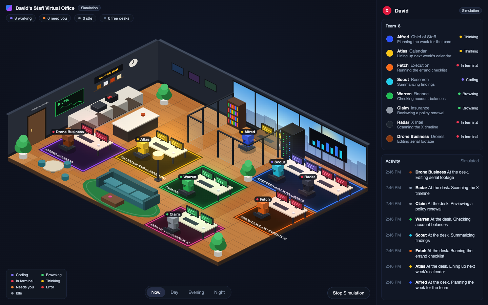

# Staff Virtual Office

一个等距视角的"Grok Bot 办公室":每个 bot 是一个小人,接到任务就走到工位干活,协作时走到对方工位交接,Alfred 召集时全员进玻璃办公室开会。
既能跑随机模拟,也能接收 Grok Bot 发来的真实状态。

参考:[@dallastesla 的演示视频](https://x.com/dallastesla/status/2115536116162216197)。画面和行为是照视频复刻的,代码全部原创,**不是**逐像素还原。



## 运行

只需要 Python 3(标准库)。浏览器里不依赖任何 CDN 或 npm 包。

```bash
python3 server.py
# 打开 http://127.0.0.1:8787/
```

默认是 **Simulation**(随机模拟)。收到第一条真实事件后自动切到 **Live**。

## 连接 Grok Bot

Grok Bot 通过 `curl` 向本机发事件,完整的提示词和事件格式见 [GROKBOT.md](GROKBOT.md)。最小例子:

```bash
curl -s -X POST http://127.0.0.1:8787/api/events \
  -H 'Content-Type: application/json' \
  -d '{"agent":"atlas","state":"coding","text":"Drafting meeting invites"}'
```

| type | 作用 |
|---|---|
| `status` | 回工位并显示状态(`coding` `browsing` `terminal` `thinking` `needsYou` `error` `idle`) |
| `handoff` | 带包裹走到另一个 bot 的工位交接 |
| `sync` | 全员开会 |

安全:服务器只监听 `127.0.0.1`;设置环境变量 `OFFICE_TOKEN` 后,发事件必须带 `Authorization: Bearer <token>`。
`text` 会原样显示在屏幕上,不要往里放密钥或隐私数据。

## 结构

```
server.py        静态页面 + 事件校验 + SSE 推送(Python 标准库)
index.html / style.css
src/
  config.js      bot 名单、桌子、地毯、墙、状态颜色(改这里就能换人换布局)
  world.js       格子地图 + 玻璃墙 + 广度优先寻路(不依赖浏览器,可在 Node 测试)
  agent.js       小人:只按动作队列执行 goto / wait / set / sit / carry
  sim.js         决定谁做什么:随机模拟 + applyEvent(真实事件)
  render.js      Canvas 等距渲染、日夜光照
  iso.js         等距投影与绘制工具
  ui.js, main.js 右侧面板、控件、主循环
tests/           sim.test.mjs(Node)、test_server.py(unittest)
```

## 测试

```bash
node --test "tests/*.test.mjs"                       # 需要 Node 22+
python3 -m unittest discover -s tests -p "test_*.py"
```

## 已知限制

- 是 2D Canvas 画的等距风格,视频里是真 3D 渲染。
- 目前只有 8 个固定工位;bot 名单改 `src/config.js` 的 `AGENTS` 和 `DESKS`。
- 云端运行的 Bot 够不到本机 `127.0.0.1`,需要隧道并务必设置 `OFFICE_TOKEN`,见 GROKBOT.md 末尾。
